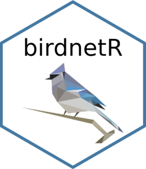

# birdnetR <a href="https://birdnet-team.github.io/birdnetR/"></a>

<!-- badges: start -->
[](https://lifecycle.r-lib.org/articles/stages.html#stable)
[](https://github.com/birdnet-team/birdnetR/actions/workflows/R-CMD-check.yaml)
[](https://CRAN.R-project.org/package=birdnetR)
<!-- badges: end -->

> [!NOTE]
> **birdnetR 1.0 is a breaking release.** All functions have new
> `birdnet_<verb>` names, and BirdNET+ V3.0 is the default model. If you are
> upgrading from 0.x, see [Upgrading from birdnetR 0.x](#upgrading-from-birdnetr-0x) below.

`birdnetR` integrates [BirdNET](https://birdnet.cornell.edu/), a state-of-the-art deep learning classifier for automated (bird) sound identification, into an R workflow.
It helps you analyze (large) audio datasets from bioacoustic projects, even without a background in computer science.

`birdnetR` is an R wrapper around the `birdnet` [Python package](https://github.com/birdnet-team/birdnet). With it you can:

- identify species in audio files with BirdNET+ V3.0 (the default), BirdNET V2.4 or Google's Perch v2,
- predict which species occur at a location and week of the year (geo models),
- extract embeddings (one feature vector per audio segment) for your own analyses,
- run custom classifiers trained with [BirdNET-Analyzer](https://github.com/birdnet-team/BirdNET-Analyzer).

To train custom classifiers, use BirdNET-Analyzer directly.


## Installation

Install the released version from CRAN:

```r
install.packages("birdnetR")
```
<br>
or install the development version from GitHub with:

```r
pak::pak("birdnet-team/birdnetR")
```

You don't need to install Python yourself. On first use, birdnetR sets up Python
and the `birdnet` package for you (through
[reticulate](https://rstudio.github.io/reticulate/)). This takes a few minutes
once. The default setup is small. TensorFlow (about 600 MB) or PyTorch are
downloaded only when you first load a model that needs them.


## Example use

Identify species in an audio file:

```r
library(birdnetR)

# Load the BirdNET+ V3.0 acoustic model (downloaded on first use)
model <- birdnet_load()

# Path to an audio file (replace with your own file path)
audio_path <- system.file("extdata", "soundscape.mp3", package = "birdnetR")

# Predict species within the audio file
predictions <- birdnet_predict(model, audio_path)

# Convert predictions to a data frame
df <- as.data.frame(predictions)
```

Each row of `df` is one detection: the file (`input`), the segment's
`start_time` and `end_time` in seconds, the `species_name`
(`"<scientific name>_<common name>"`) and the `confidence` score.

Other models load the same way:

```r
model_24 <- birdnet_load(version = "2.4")   # BirdNET V2.4
perch <- birdnet_load_perch()               # Google's Perch v2
geo <- birdnet_load(type = "geo")           # species expected at a place and week
```


## Working with prediction results

`birdnet_predict()` returns a lightweight Python-backed object, not an R data
frame. Use `as.data.frame()` when you need the results in R. For large runs, it
is faster to skip the conversion and write the results to a file directly:

```r
predictions <- birdnet_predict(model, audio_path)

# Faster for large runs; the data stays in Python:
birdnet_write(predictions, "results.parquet")

# Only when you need the results in R:
df <- as.data.frame(predictions)
```


## Models

| Model | Load with | Classes | License of the model files |
|---|---|---|---|
| BirdNET+ V3.0 acoustic (default) | `birdnet_load()` | about 11,700 | Apache 2.0 |
| BirdNET+ V3.0 geo | `birdnet_load(type = "geo")` | about 14,000 | CC BY-NC-SA 4.0 |
| BirdNET V2.4 acoustic | `birdnet_load(version = "2.4")` | 6,522 | CC BY-NC-SA 4.0 |
| BirdNET V2.4 geo | `birdnet_load(type = "geo", version = "2.4")` | 6,522 | CC BY-NC-SA 4.0 |
| Perch v2 (Google) | `birdnet_load_perch()` | 14,795 | see [Google's model page](https://www.kaggle.com/models/google/bird-vocalization-classifier) |

`birdnet_list_models()` lists every backend and precision you can choose. The
[Get started](https://birdnet-team.github.io/birdnetR/articles/birdnetR.html)
article explains its columns. For details on each model, see the
[models page of the Python package](https://birdnet-team.github.io/birdnet/models.html).


## Upgrading from birdnetR 0.x

Version 1.0 is a breaking release. The table below maps removed functions to
their replacements:

| 0.3.2 | 1.0.0 |
|---|---|
| `birdnet_model_tflite()` | `birdnet_load(version = "2.4", backend = "tf")` |
| `birdnet_model_protobuf()` | `birdnet_load(version = "2.4", backend = "pb")` |
| `birdnet_model_meta()` | `birdnet_load(type = "geo", version = "2.4")` |
| `birdnet_model_custom()` | `birdnet_load_custom()` |
| `predict_species_from_audio_file()` | `birdnet_predict(model, files = ...)` |
| `predict_species_at_location_and_time()` | `birdnet_predict(model, latitude = ..., longitude = ...)` |
| `labels_path()` / `read_labels()` | `birdnet_list_species(model)` |
| `available_languages()` | `birdnet_list_languages()` |
| `get_top_prediction()` | Removed; use `dplyr` or `birdnetTools` |

Predictions now come back as an object (convert with `as.data.frame()`), and
the output columns follow the Python package (`input`, `start_time`,
`end_time`, `species_name`, `confidence`). `NEWS.md` lists the renamed
arguments and all other changes.


## The BirdNET ecosystem

`birdnetR` is part of a set of related tools:

- **[BirdNET-Analyzer](https://github.com/birdnet-team/BirdNET-Analyzer)** — the upstream desktop/CLI application for custom classifier training and advanced BirdNET features.
- **[birdnetTools](https://birdnet-team.github.io/birdnetTools/index.html)** — an R package for post-processing and validating BirdNET predictions: filtering, visualisation, and interactive threshold setting.


## Citation

Feel free to use `birdnetR` for your acoustic analyses and research. If you do, please cite as:

```bibtex
@article{kahl2021birdnet,
  title={BirdNET: A deep learning solution for avian diversity monitoring},
  author={Kahl, Stefan and Wood, Connor M and Eibl, Maximilian and Klinck, Holger},
  journal={Ecological Informatics},
  volume={61},
  pages={101236},
  year={2021},
  publisher={Elsevier}
}
```


## License

- **Source code**: The source code of this package is licensed under the [MIT License](https://opensource.org/licenses/MIT).
- **Models**: The BirdNET+ V3.0 acoustic model is licensed under the [Apache License 2.0](https://www.apache.org/licenses/LICENSE-2.0) and comes with an acceptable use policy. The other BirdNET models are licensed under the [Creative Commons Attribution-NonCommercial-ShareAlike 4.0 International License (CC BY-NC-SA 4.0)](https://creativecommons.org/licenses/by-nc-sa/4.0/). Perch v2 is a model by Google; see [Google's model page](https://www.kaggle.com/models/google/bird-vocalization-classifier) for its terms.

Please review and follow the license terms of each model; see the [license section of the Python package](https://github.com/birdnet-team/birdnet#license). Note that educational and research purposes are considered non-commercial use cases.

## Funding

Our work in the K. Lisa Yang Center for Conservation Bioacoustics is made possible by the generosity of K. Lisa Yang to advance innovative conservation technologies to inspire and inform the conservation of wildlife and habitats.

The development of BirdNET is supported by the German Federal Ministry of Research, Technology and Space (FKZ 01|S22072), the German Federal Ministry for the Environment, Climate Action, Nature Conservation and Nuclear Safety (FKZ 67KI31040E), the German Federal Ministry of Economic Affairs and Energy (FKZ 16KN095550), the Deutsche Bundesstiftung Umwelt (project 39263/01) and the European Social Fund.

## Partners

BirdNET is a joint effort of partners from academia and industry.
Without these partnerships, this project would not have been possible.
Thank you!


